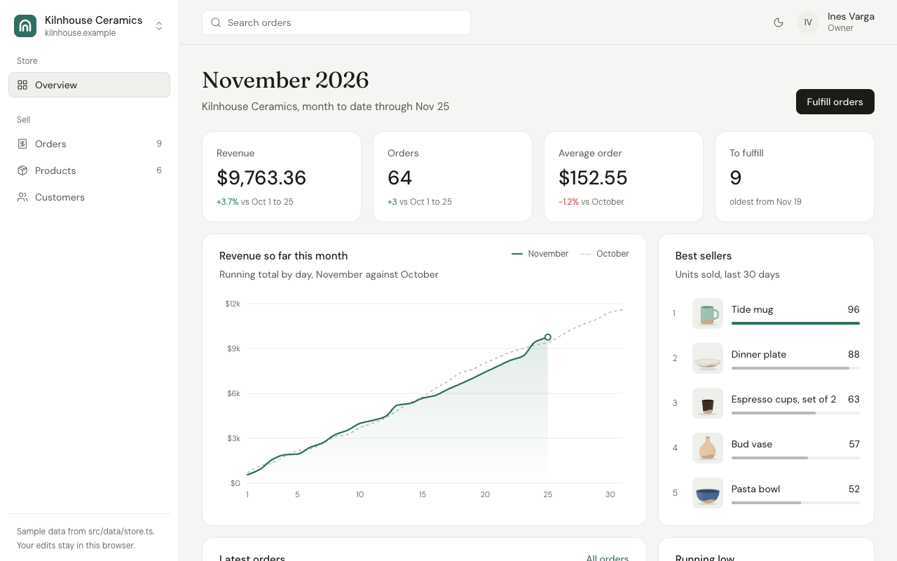

# Kilnhouse: ecommerce admin dashboard template

A free ecommerce admin dashboard template in React: sales overview, orders with status filters, order detail with a timeline, products with stock levels and an edit form, and customers. Static, fast and easy to make your own.



[](https://console.cloudzyro.com/new?repo=https://github.com/Cloudzyro/template-ecommerce-admin)

## What's included

- Sidebar with a store switcher and grouped menu, a search bar that jumps to orders, and a slide-out menu on phones and tablets
- Overview: revenue, orders, average order and orders to fulfill, a month-to-date revenue chart against last month (hover for each day), best sellers and a running-low list
- Orders: status tabs with counts (all, unfulfilled, unpaid, fulfilled, returned), search by order number, customer or email, sortable columns and pagination
- Order detail: line items with product pictures, totals with shipping and tax, payment and fulfillment status, a timeline of events, the customer and shipping address, and a working Mark as fulfilled button
- Products: stock per product with low and out-of-stock notes, a stock filter, search by title or SKU, and sorting
- Product editor: title, description, price, compare-at price, status, collection, and SKU and stock for each glaze, with validation, a live preview and a saved confirmation
- Customers: a sortable, searchable list and a page per customer with their orders
- Product pictures drawn in code (no photos), so they scale cleanly and change color with each variant
- Edits and fulfilled orders are kept in the browser's localStorage, so the demo feels real; nothing is sent anywhere
- Light and dark themes, hash routing that works on any static host, and accessible tables, tabs, labels and focus styles

## Run it locally

```bash
pnpm install
pnpm dev        # http://localhost:5173
pnpm build      # static site in dist/
pnpm preview    # serve the built site
```

## Make it yours

- **Store, menu, products, glazes, customers and orders:** everything lives in `src/data/store.ts`. The orders are generated from a fixed seed so the sample stays the same; replace them with your own array or an API call. The editable copy of products and orders (and the localStorage saving) is in `src/lib/state.tsx`, which is the place to call your own API.
- **Product pictures:** `src/components/Pot.tsx` draws each shape. Glaze colors come from `glazes` in the data file. For real photos, swap `<Pot>` for an `` with alt text.
- **Colors:** edit the CSS variables in `src/index.css` (`:root` for light, `.dark` for dark). The accent is `--accent`; the chart uses `--chart-now` and `--chart-then`.
- **Fonts:** DM Sans and Fraunces are self-hosted through Fontsource and imported at the top of `src/index.css`. Fraunces is used only for page titles (`.page-title`).
- **Pages:** add a page in `src/pages/`, a route in `src/main.tsx` and a menu item in `nav` in the data file.
- **Sign-in:** there's none. Put the app behind your own auth (for example Supabase Auth, Clerk or your host's access controls) before using real data.
- **Social card:** replace `public/og-image.png` (1200x630).

Optional build-time variables:

| Variable | What it does |
| --- | --- |
| `VITE_SITE_URL` | Your public address, used for the social card and sitemap |
| `VITE_ALLOW_INDEXING` | Set to `true` to let search engines index the site. Off by default, since admin screens are usually private |

## Routing on static hosts

The app uses React Router's hash router, so addresses look like `/#/orders/1350`. The part after `#` never reaches the server, which only ever sends `index.html`, so deep links and refreshes work on any static host with no rewrite rules. The build also writes `dist/404.html`, so a mistyped path still opens the app.

## Deploy

Click the **Deploy to Cloudzyro** button above, or push your own copy to GitHub and connect it in the Cloudzyro console. The build command is `pnpm build` and the output folder is `dist`. No server is needed.

## Stack

- [React](https://react.dev) 19 and [React Router](https://reactrouter.com) 8
- [Vite](https://vite.dev) 8
- [Tailwind CSS](https://tailwindcss.com) 4
- TypeScript
- [Lucide](https://lucide.dev) icons

## License

MIT, see [LICENSE](./LICENSE).
